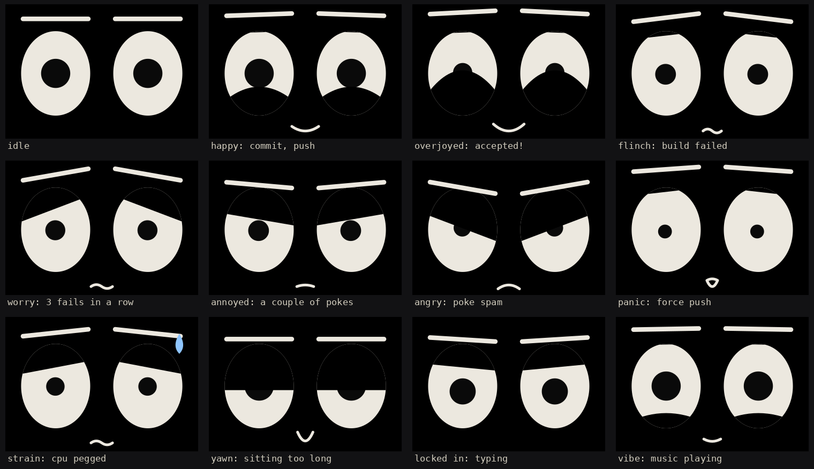
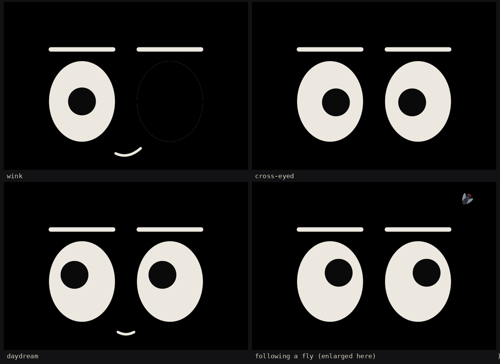
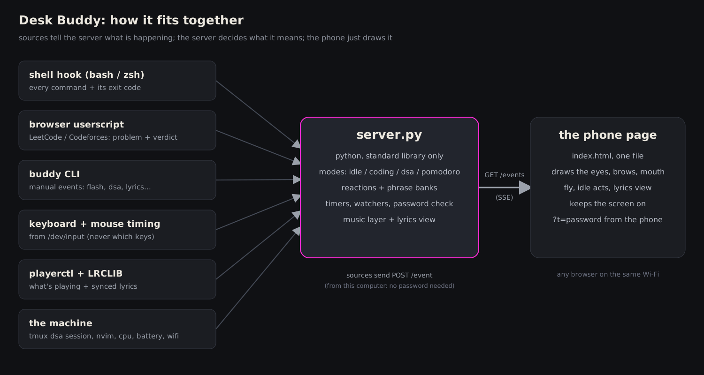

# Desk Buddy

A pair of eyes for an old phone. It sits under the monitor, watches what happens at the desk, and reacts: it winces when a build fails, grins when you commit, goes serious while you type, panics on a force push, and follows a fly around the screen when nothing is going on. When music is playing it shows the synced lyrics.

It is a small personal project: one Python file on the laptop, one HTML file on the phone, no frameworks, no build step.




## What it does

- **Reacts to what you do.** Failed or passed builds and tests, `git commit` / `push` / `push --force` / `reset --hard`, typing hard, a CPU running flat out, a low battery, the network dropping, sitting for too long, working late.
- **Knows what you are working on.** Open `nvim` and it says so. Open a `dsa` tmux session, or a LeetCode / Codeforces tab, and it shows the problem and a timer, with a hint every few minutes.
- **Reacts to LeetCode and Codeforces submissions.** Accepted, wrong answer, time limit, runtime error. Accepted counts toward a streak.
- **Does things when idle.** Winks, goes cross-eyed, glances at the clock, daydreams, sneezes, yawns, and sometimes a fly buzzes around the screen while the eyes follow it.
- **Shows lyrics.** Whatever `playerctl` reports is playing gets its synced lyrics from LRCLIB. Lyrics are a layer on top of everything else, so the face can be angry while the lyrics keep going.
- **Has a lyrics-only view.** `./buddy lyrics` turns the whole screen into a big lyrics page (and `./buddy face` brings the eyes back).
- **Says things.** Every reaction has several lines, never the same one twice in a row, and some depend on context (the 5th commit of the day, the 4th failed build in a row, the time of day).
- **Can be poked.** Tap the phone: startled, annoyed, angry, and finally it ignores you.



## How it fits together



Sources send small JSON events to the server (`POST /event`). The server decides what they mean and keeps the current state. The phone page connects once (`GET /events`, server-sent events) and draws whatever the server says. The page holds no logic about your machine, so it can be reloaded at any time and picks up exactly where things are.

## Quick start

**Requirements:** Linux, Python 3.10+. The server uses only the standard library. Everything else is optional and only switches on a feature:

| Tool | Used for |
|---|---|
| `playerctl` | now playing + lyrics |
| `tmux` | detecting the `dsa` session |
| `pgrep` | detecting `nvim` |
| `xdotool`, `xprintidle` | exact cursor and idle time on X11 |
| `dbus-monitor` | glancing toward the corner when a desktop notification arrives |
| `curl` | the shell hook |
| read access to `/dev/input` | typing detection and idle time (add yourself to the `input` group) |

```sh
python3 server.py
```

The server prints two URLs:

```
phone:  http://192.168.1.20:3030/?t=<password>
laptop: http://localhost:3030/   (local needs no password; phone/LAN needs ?t=)
```

Open the `phone:` URL on the phone once (same Wi-Fi), tap the screen once to go fullscreen and keep it awake, and save it as a bookmark or add it to the home screen. Keep the `?t=` part.

On the laptop you can just open `http://localhost:3030/` to see the same thing.

## Commands

```sh
./buddy flash happy                 # make it react: happy overjoyed win flinch worry annoyed angry panic strain yawn focus
./buddy lyrics                      # lyrics-only view (toggle); also: lyrics on | lyrics off
./buddy face                        # back to the eyes
./buddy dsa "Two Sum"               # start dsa mode with a problem name and a timer
./buddy solved "Two Sum"            # record a solved problem (streak) and celebrate
./buddy mode coding                 # force a mode: idle | coding | dsa
./buddy typing 8                    # hold the "locked in" look for 8 seconds (for testing)
./buddy build-pass | build-failed | terminal-error
./buddy pomo start [focus short long]   # also: pomo skip | pomo stop
```

Tip: `alias ly='~/path/to/desk-buddy/buddy lyrics'` gives you a two-key lyrics toggle.

## Hooking it up

### Shell hook (builds, tests, git, errors)

This is what makes it react to your terminal without you telling it anything. Add one line to `~/.zshrc` or `~/.bashrc`:

```sh
source ~/path/to/desk-buddy/hooks/buddy-shell.sh
```

After every command it sends the command line and exit code to the local server. The server only classifies it (git / build tool / error) and never stores or forwards it.

| You run | It does |
|---|---|
| `git commit` | happy; the first commit of the day and every 5th get their own lines |
| `git push` | happy, or flinch if rejected |
| `git push --force`, `-f`, `--force-with-lease`, `+branch` | panic |
| `git reset --hard` | flinch |
| failed `git merge` / `rebase` / `cherry-pick` | worry |
| `make`, `cmake`, `gcc`, `g++`, `clang`, `cargo build/test`, `go build/test`, `npm test/build`, `pytest`, `python -m pytest`, ... | pass: happy; fail: flinch; a streak of fails: worry with calmer and calmer lines; pass after a streak: overjoyed |
| anything that exits non-zero | flinch (Ctrl-C, `grep`, `diff` and similar are ignored) |
| a command that succeeds after 30 s or more | happy, "done" |

It looks through `cd build && make`, `sudo make install`, `CC=gcc make` and `pytest | tee log`. Tested in bash and zsh (including with Powerlevel10k, which runs other prompt hooks first).

Only commands typed in a terminal where the hook is loaded are seen. Commits from an editor or a GUI are not. For those, `hooks/install-git-hooks.sh` (run it inside a repo) installs a `post-commit` and a `pre-push` hook; it keeps any existing hook as `.bak`.

### LeetCode and Codeforces

`hooks/buddy-judge.user.js` is a userscript. Install a userscript manager (Violentmonkey or Tampermonkey), create a new script, paste the file, save. On Chrome-based browsers you may also need to switch on "Allow User Scripts" for the extension.

While one of those sites is the tab in front, Buddy shows the problem name and a timer (dsa mode); when you close the tab it goes back to normal after a few seconds. Submissions are reported as accepted / wrong answer / time limit / memory limit / runtime error / compile error. The script sends the site, the problem name and the verdict word, nothing else.

Set `const DEBUG = true;` at the top of the script to see in the browser console what it sees and sends. LeetCode and Codeforces can change their pages, so if verdicts stop being noticed, that is the first place to look.

### The `dsa` session

A tmux session named `dsa` that is attached somewhere puts Buddy in dsa mode ("what are we solving today?", a timer, and a hint every few minutes). Detaching or killing the session ends it. `./buddy dsa "name"` does the same with a title; put it in your own `dsa` command to pass the problem name along.

## Music and lyrics

`playerctl` reports the player; lyrics come from [LRCLIB](https://lrclib.net) (synced `.lrc` lines, cached per track). Nothing needs configuring if `playerctl metadata` works.

```sh
BUDDY_PLAYER=firefox python3 server.py        # pick one player when several are running (see: playerctl -l)
BUDDY_LYRIC_OFFSET=0.4 python3 server.py      # seconds; positive shows each line earlier
BUDDY_ACCENT='#00ffaa' python3 server.py      # glow colour of the lyrics view
```

Add `&size=1.3` to the phone URL to scale the lyrics view.

With music playing and nothing else going on, the face has a calm content look and, now and then, a slow sway. It deliberately does not twitch to the beat. Idle acts, typing, build results and pokes all still take over the face when they happen, and the lyrics stay up.

## Everything it reacts to

| Thing | When |
|---|---|
| Typing | about 8 key presses in 5 s turns on the "locked in" look; it ends ~3 s after you stop. Typing hard (20+ in 5 s) also gets a line, at most once every 10 minutes. Only the timing of key presses is used, never which keys. |
| CPU | at 90%+ for about 6 s: strain (sweat drop); at 97%+ for about 25 s: panic |
| Battery | discharging at 20% or below, and again at 10%; plugging in and unplugging |
| Network | drops and comes back (needs a few consecutive checks, so brief blips are ignored) |
| Sitting | `BUDDY_SIT_MIN` minutes (default 90) of continuous activity: yawn and a nudge; a 5 minute break resets it |
| Late night | between 1am and 5am it says so every 45 minutes or so |
| Notifications | a short glance toward the corner (only the fact that one arrived is used, not its content) |
| Greetings | when a page first connects, and when you come back after 30+ minutes away; "bye" when the server is stopped |
| Idle | blinks, double blinks, squints, side-eye, wink, cross-eyed, clock glance, daydream, sneeze, yawn, a fly, little thoughts like "water?" |
| Pomodoro | `./buddy pomo start`, optional |

## Password and security

- Anything from this computer (`127.0.0.1`) is trusted and needs no password: the shell hook, `./buddy`, the userscript and `http://localhost:3030/`.
- Anything else (the phone) needs the token. It is created on first run in `.buddy_token` (readable only by you), or set it yourself with `BUDDY_TOKEN=...`. `BUDDY_TOKEN=off` turns the check off.
- **Add `.buddy_token` to `.gitignore`.**
- The connection is plain HTTP, so on a shared network (a campus Wi-Fi, say) someone sniffing traffic could read the token. It keeps casual visitors out; it is not strong protection. What an intruder could see or send is limited to the face, the now-playing line and events, nothing on the machine.
- The server listens on all interfaces so the phone can reach it. Run it only on networks you are happy with.

## Sending your own events

```sh
curl -XPOST localhost:3030/event -d '{"type":"flash","mood":"happy","text":"hello"}'
curl -XPOST localhost:3030/event -d '{"type":"mode","value":"coding"}'
curl -XPOST localhost:3030/event -d '{"type":"view","view":"lyrics"}'
curl -XPOST localhost:3030/event -d '{"type":"cmd","line":"make","code":2}'
```

From another machine add the header `X-Buddy-Token: <token>`.

## Keeping the phone awake

The page tries the Wake Lock API first. That only exists on `https://` or `localhost`, and the phone usually loads a plain `http://192.168...` address, so it falls back to looping a tiny silent video (the NoSleep.js trick). Either way it needs one tap on the page first. The bottom-left status line shows `screen kept on` or `tap once to keep screen on`.

If the screen still sleeps, switch on Android's developer option **Stay awake** (while charging), which is the reliable fix for a phone that lives on a charger.

## Files

```
server.py                  the whole server (standard library only)
index.html                 the phone page: face, idle acts, lyrics view
buddy                      command line client
hooks/buddy-shell.sh       bash / zsh hook
hooks/buddy-judge.user.js  LeetCode / Codeforces userscript
hooks/install-git-hooks.sh optional git hooks for commits made outside a terminal
docs/                      images used in this README
.buddy_token               created on first run (keep out of git)
dsa_history.json           created when you record solved problems
```

## Status and known limits

- Tested: the server logic, the shell hook in bash and zsh, the git hook installer, the userscript logic against mock pages, and the page in a simulated browser.
- Not verified on every setup: the real LeetCode and Codeforces pages (their markup can change), how the keep-awake fallback behaves on your particular phone and browser, and reading `/dev/input` without the right group.
- On Wayland the exact cursor position is not available to normal programs, so the eyes follow an estimate built from mouse and touchpad movement. X11 with `xdotool` is exact.
- The coding mode detects `nvim` only.
- It is a hobby project with no tests in the repository and no authentication beyond the shared token.
