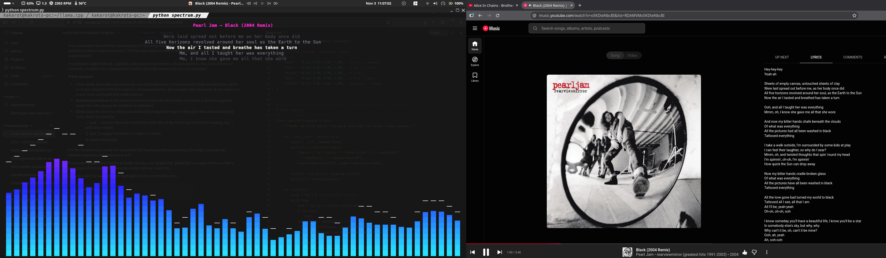

# lyrics_visualize

A terminal audio visualizer with synced lyrics.



It listens to whatever my laptop is playing, draws smooth colored bars in the terminal that move with the music, and shows the current lyric line above them, in time with the song. All in one Python file, `spectrum.py`.

Made by Claude alone.

## What it does

- **Bars:** captures the system's output audio, runs an FFT, and draws log-spaced bars with peak caps in truecolor, using 1/8-height block characters so the motion looks smooth.
- **Lyrics:** reads the current song and position from whatever player is running, fetches time-synced lyrics from [LRCLIB](https://lrclib.net) (free, no API key), and highlights the current line.

## Requirements

Built and tested on Manjaro (PipeWire). Should work on any Linux with PulseAudio or PipeWire-pulse.

```bash
sudo pacman -S libpulse python-numpy playerctl
```

- `libpulse` gives `parec`, which captures the audio
- `python-numpy` does the FFT
- `playerctl` reads what's playing (artist, title, position)

Your terminal needs truecolor support. Most modern ones have it.

## Run it

```bash
python spectrum.py
```

Some options:

```bash
python spectrum.py --theme sunset --gain -6
python spectrum.py --player firefox --lyric-offset 0.3
python spectrum.py --no-lyrics
```

| Option | What it does |
|--------|--------------|
| `--theme` | `neon` (default), `fire`, `matrix`, `ice`, `sunset` |
| `--gain` | Extra gain in dB. Go negative if the bars are too tall |
| `--range` | How many dB the bars span. Smaller means more contrast |
| `--decay` | How fast bars fall. Higher is smoother, lower is snappier |
| `--width`, `--gap` | Bar width and spacing in columns |
| `--player` | Pick a specific player for lyrics, e.g. `firefox`, `spotify` |
| `--lyric-offset` | Shift lyrics by this many seconds |
| `--source` | Capture from a specific audio source instead of the default |
| `--no-lyrics` | Bars only |

Keys while running:

| Key | What it does |
|-----|--------------|
| `,` `.` | Jump to the previous / next lyric line |
| `[` `]` | Nudge lyrics 0.5 s later / earlier |
| `0` | Reset the nudge |
| `Ctrl-C` | Quit |

## How it works (short version)

1. `parec` streams the audio from the output's monitor source. A thread keeps the latest 4096 samples.
2. Every frame: Hann window, FFT, group bins into log-spaced bands, convert to dB, tilt the spectrum so the bass doesn't dominate, smooth it, draw it.
3. A second thread polls `playerctl` for the song and position. A third fetches lyrics from LRCLIB when the song changes.
4. The current lyric line is found with a binary search on the timestamps, using the playback position.

## Known quirks

- Works best with YouTube Music, which reports a proper playback position. Regular YouTube in Firefox often reports a stuck position, so the script keeps its own clock and shows "position estimated". Use `,` `.` to catch up if the lyrics are off.
- Lyrics come from LRCLIB, so obscure songs, remixes and odd uploads may show "no lyrics found".
- Lyrics in non-Latin scripts may not center perfectly.

## Status

Works on my machine. Ideas for later: a karaoke-style highlight on the current line, other modes (waterfall, braille wave), and sending the current lyric line to a small ESP32 display on my desk.
