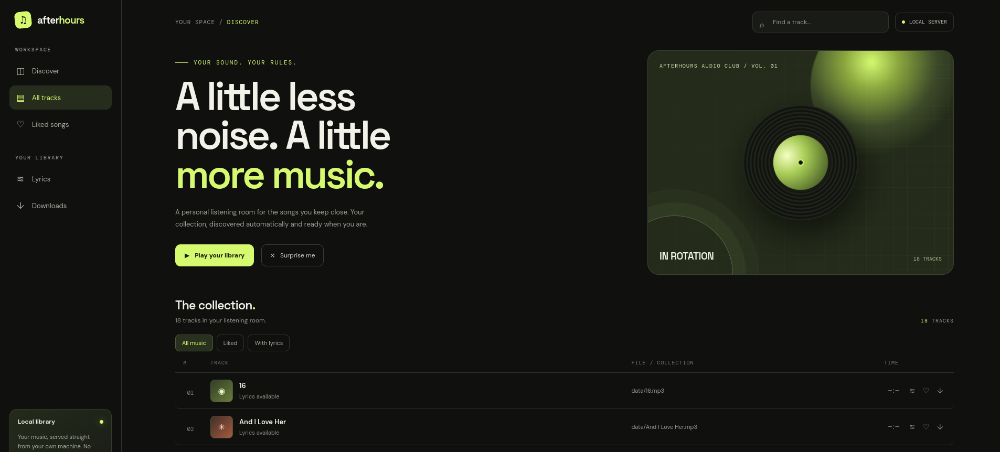
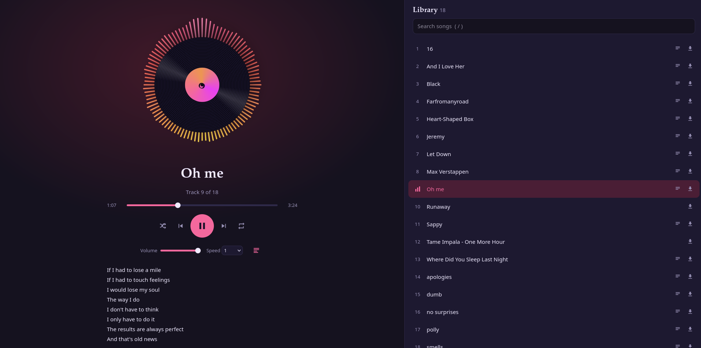
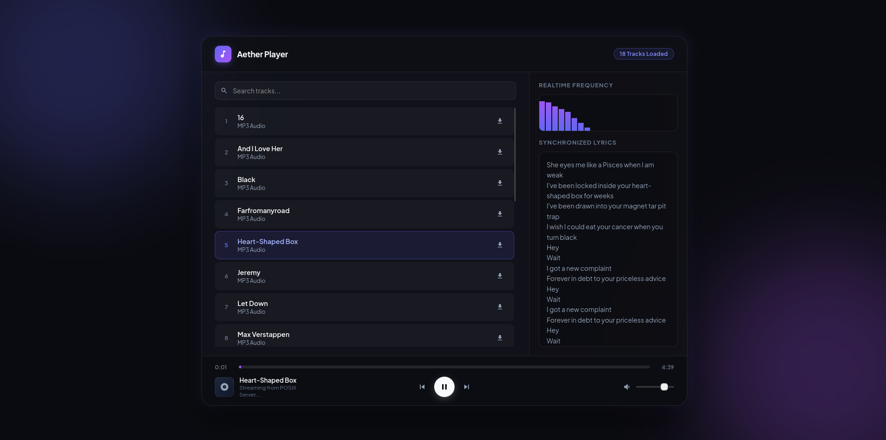

# Frontend Showdown: ChatGPT vs Claude vs Gemini

A small one-shot experiment on top of **[posix-server-nirvana](https://github.com/Udbhav-Dubey/posix-server-nirvana/)**, my HTTP server written from scratch in C++ on POSIX sockets.

## The Experiment

Every model got the **same prompt** along with the server's source code. The job: write a frontend for it that streams music and shows lyrics from the `data/` folder. One shot, no follow-ups.

| Model | Folder | Screenshot |
|-------|--------|------------|
| ChatGPT | `chatgpt/index.html` | `chatgpt.png` |
| Claude | `claude/index.html` | `claude.png` |
| Gemini | `gemini/index.html` | `gemini.png` |

## The Results

### ChatGPT ("afterhours")



It rebuilt everything from scratch instead of building on the original. The result looks a lot like Spotify, which is fine, but the theme is basically just green and never changes.

What it did well: it was the only one to add a **Up Next** section and a **Liked** section. Nobody else thought of that.

The lyrics were the weak spot. They are just written out in one place and don't feel part of the player.

### Claude



My favourite. It didn't throw the original away, it **upgraded** it. The music visualizer is the highlight: the waves around the vinyl react to the sound, and it looks great. The accent colour also **changes with each song**, so the whole page feels alive.

Lyrics sit right under the controls, which works well. Shuffle, repeat, playback speed and a `/` shortcut for search are nice extras.

### Gemini ("Aether Player")



Clean and simple, with a realtime frequency bar and synchronized lyrics panel. The lyrics were alright, and since they sit right beside the track list they are easy to follow, better than ChatGPT's. The colour choices are a bit weird though, and overall it feels the least polished of the three.

## Verdict

1. **Claude**: best visuals, reacts to the music, per-song colours, improved on the original
2. **ChatGPT**: best feature ideas (Up Next, Liked), but looks like a Spotify clone with a fixed green theme
3. **Gemini**: solid lyrics placement, odd colours

This is just my personal opinion from a single run, so take it with a grain of salt.

## Running It

```bash
mkdir -p build && cd build
cmake ..
make
./nirvana
```

Put your `.mp3` files and matching `.txt` lyrics in `data/`, then open the server in your browser.

## Project Layout

```
├── src/ + include/   C++ server (HttpResponse, Router, server, Songs, utils)
├── data/             mp3 files and lyrics
├── chatgpt/          ChatGPT's frontend
├── claude/           Claude's frontend
├── gemini/           Gemini's frontend
└── CMakeLists.txt
```
